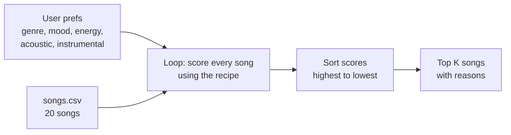

# 🎵 Music Recommender Simulation

## Project Summary

In this project you will build and explain a small music recommender system.

Your goal is to:

- Represent songs and a user "taste profile" as data
- Design a scoring rule that turns that data into recommendations
- Evaluate what your system gets right and wrong
- Reflect on how this mirrors real world AI recommenders

My version is called **TuneTwin 1.0**. It reads a catalog of 20 songs from a CSV file, compares each one to a user's taste (favorite genre, favorite mood, how energetic they want the music, and whether they like acoustic or instrumental songs), and gives every song a score out of 5. Then it shows the top 5 songs in the terminal, along with the exact reasons each one earned its points. I tested it with 8 different user profiles, including some tricky ones made to confuse it, and wrote up what worked and what didn't in the [model card](model_card.md).

---

## How The System Works

Apps like Spotify and YouTube figure out what you might like next by mixing two ideas. The first one looks at other people: if someone has music taste like yours and they love a song you haven't heard yet, the app guesses you'll like it too. The second one looks at the song itself, like its genre, how energetic it is, or what mood it gives off, and finds songs that feel similar to the ones you already play. They also keep learning from what you do, like when you skip a song, replay it, or add it to a playlist. My version is a lot smaller and only uses the second idea, matching songs by what they are like. It cares most about genre, because that's the part of someone's taste that doesn't really change. Mood comes next, since it depends on what you're doing (gym vs. studying). After that it looks at energy, and it gives points for being _close_ to what the user wants, not just for being higher or lower. So a calm song isn't "worse" than a loud one, it just depends on the user.

**Features each `Song` uses:**

- `genre`: the type of music (pop, lofi, rock, jazz, etc.)
- `mood`: the feeling of the song (happy, chill, intense, etc.)
- `energy`: how calm or intense it is, from 0 to 1
- `acousticness`: how acoustic it sounds, from 0 to 1
- `instrumentalness`: how much of the song has no singing, from 0 to 1 (I added this column to the dataset)

I'm not using `tempo_bpm` or `danceability` for now. In this dataset they go up and down almost the same way as energy, so adding them would basically count energy three times.

I also grew the catalog from 10 to 20 songs, adding genres and moods that weren't there before (hip-hop, country, classical, r&b, metal, reggae, edm, folk, latin, blues).

**What the `UserProfile` stores:**

- `favorite_genre`: the genre they like most
- `favorite_mood`: the mood they're looking for
- `target_energy`: how energetic they want the music to be (0 to 1)
- `likes_acoustic`: true or false, whether they like acoustic songs
- `likes_instrumental`: true or false, whether they like songs without singing

The profile I'm testing with is a "study session" listener: lofi, chill, energy 0.40, likes acoustic, likes instrumental.

**My Algorithm Recipe**

Every song starts at 0 and earns points for each way it matches the user:

| Check                                                                                            | Points     |
| ------------------------------------------------------------------------------------------------ | ---------- |
| Genre matches                                                                                    | +2.0       |
| Mood matches                                                                                     | +1.0       |
| Energy closeness: `1 - abs(song energy - target energy)`                                         | up to +1.0 |
| Acoustic matches what the user likes (acousticness 0.5 or higher counts as acoustic)             | +0.5       |
| Instrumental matches what the user likes (instrumentalness 0.5 or higher counts as instrumental) | +0.5       |

The best possible score is 5.0. Genre is worth more than mood because genre is a long-term taste, while mood changes depending on what you're doing. I tried mood at 1.5 too, but the top 5 didn't change for any of the profiles I tested, so I kept it simple at 1.0. Each time a song earns points, the program also saves a short reason so it can explain why it picked that song.

**How songs get picked:** every song gets a score, then the list is sorted from highest to lowest and the top `k` songs (5 by default) are recommended. Scoring tells me how good _one_ song is, and ranking compares _all_ of them so the user only sees the best few.

**How the data flows:**



**Biases I expect:**

- It might over-prioritize genre. A song that matches the user's mood and energy perfectly can still lose to a so-so song that just has the right genre label.
- Genre and mood only count if the words match exactly, so "indie pop" doesn't count as "pop" and "relaxed" doesn't count as "chill", even though they're really close.
- Genres with more songs in the catalog (like lofi with 3) have a better chance of filling the top 5 than genres with only 1 song (like rock or metal).
- It doesn't look at whether a song sounds happy or sad, so a calm sad song and a calm happy song can score about the same.

---

## Getting Started

### Setup

1. Create a virtual environment (optional but recommended):

   ```bash
   python -m venv .venv
   source .venv/bin/activate      # Mac or Linux
   .venv\Scripts\activate         # Windows

   ```

2. Install dependencies

```bash
pip install -r requirements.txt
```

3. Run the app:

```bash
python -m src.main
```

### Running Tests

Run the starter tests with:

```bash
pytest
```

You can add more tests in `tests/test_recommender.py`.

---

## Sample Recommendation Output

This is what I get when I run `python -m src.main`. The default profile is pop/happy, and I also run my study session profile to compare:

```
Loaded songs: 20

============================================================
  Profile: Pop / Happy
  genre=pop | mood=happy | energy=0.80 | acoustic=no | instrumental=no
============================================================

  #1  Sunrise City  (Neon Echo)
      Score: 4.98 / 5.00
      Why:
        - genre match (+2.0)
        - mood match (+1.0)
        - energy close to target (+0.98)
        - acoustic preference match (+0.5)
        - instrumental preference match (+0.5)

  #2  Gym Hero  (Max Pulse)
      Score: 3.87 / 5.00
      Why:
        - genre match (+2.0)
        - energy close to target (+0.87)
        - acoustic preference match (+0.5)
        - instrumental preference match (+0.5)

  #3  Rooftop Lights  (Indigo Parade)
      Score: 2.96 / 5.00
      Why:
        - mood match (+1.0)
        - energy close to target (+0.96)
        - acoustic preference match (+0.5)
        - instrumental preference match (+0.5)

  #4  Concrete Crown  (Verse Theory)
      Score: 1.98 / 5.00
      Why:
        - energy close to target (+0.98)
        - acoustic preference match (+0.5)
        - instrumental preference match (+0.5)

  #5  Fiesta de Fuego  (Los Brillantes)
      Score: 1.95 / 5.00
      Why:
        - energy close to target (+0.95)
        - acoustic preference match (+0.5)
        - instrumental preference match (+0.5)

============================================================
  Profile: Study Session
  genre=lofi | mood=chill | energy=0.40 | acoustic=yes | instrumental=yes
============================================================

  #1  Midnight Coding  (LoRoom)
      Score: 4.98 / 5.00
      Why:
        - genre match (+2.0)
        - mood match (+1.0)
        - energy close to target (+0.98)
        - acoustic preference match (+0.5)
        - instrumental preference match (+0.5)

  #2  Library Rain  (Paper Lanterns)
      Score: 4.95 / 5.00
      Why:
        - genre match (+2.0)
        - mood match (+1.0)
        - energy close to target (+0.95)
        - acoustic preference match (+0.5)
        - instrumental preference match (+0.5)

  #3  Focus Flow  (LoRoom)
      Score: 4.00 / 5.00
      Why:
        - genre match (+2.0)
        - energy close to target (+1.00)
        - acoustic preference match (+0.5)
        - instrumental preference match (+0.5)

  #4  Spacewalk Thoughts  (Orbit Bloom)
      Score: 2.88 / 5.00
      Why:
        - mood match (+1.0)
        - energy close to target (+0.88)
        - acoustic preference match (+0.5)
        - instrumental preference match (+0.5)

  #5  Coffee Shop Stories  (Slow Stereo)
      Score: 1.97 / 5.00
      Why:
        - energy close to target (+0.97)
        - acoustic preference match (+0.5)
        - instrumental preference match (+0.5)
```

**Screenshot or video** _(optional)_: <!-- Insert a screenshot or demo video link here -->

---

## Experiments You Tried

**Weight shift: genre 2.0 → 1.0, energy 1.0 → 2.0**

I cut the genre weight in half and doubled the energy weight. The best possible score stayed at 5.0, so the math still worked. Six of my eight profiles kept the exact same top 5 in the same order, and only the numbers changed. Two got a little better:

| Profile | What changed |
|---|---|
| Pop / Happy | Rooftop Lights (happy indie pop) moved above Gym Hero (intense pop) |
| Acoustic Headbanger | The calm lofi and jazz songs dropped out and louder songs took their place |

For the rock fan, Iron Tempest (metal) still ranked behind Fiesta de Fuego (latin), because the real problem is that "metal" doesn't count as "rock," and changing weights can't fix that. Since the results were mostly just different and not more accurate, I went back to the original weights.

**Mood weight: 1.5 vs. 1.0**

While planning, I compared mood at 1.5 and 1.0 on five profiles. The top 5 was the same every time, so I went with 1.0 to keep it simple and make sure genre always beats mood.

**Different types of users**

I ran 3 normal profiles (Pop / Happy, Study Session, Deep Intense Rock) and 5 edge cases (Sad but Hyped, Acoustic Headbanger, Capital Letters, Not in Catalog, Energy Too High). The normal ones all got a near-perfect #1 song. The edge cases showed where it breaks, like a capital "P" in "Pop" wiping out 3 points. The full outputs and comparisons are in section 7 of the [model card](model_card.md).

---

## Limitations and Risks

- **"Likes acoustic" secretly means "likes calm."** Every acoustic song in my catalog is also low energy, so someone who wants loud acoustic music or calm electronic music can't really be served.
- **Matching is too strict.** Genre and mood only count if the words match exactly, so "metal" gets nothing for a rock fan, and even "Pop" with a capital P doesn't match "pop."
- **The catalog is tiny.** There are only 20 songs, and most genres have just one, so after the first match or two the rest of the list is filler.
- **It never says "nothing fits."** If no song matches your genre or mood, it still confidently gives you five songs.
- **Ties are not handled in a smart way.** If two songs get the same score, they just stay in the order they appear in `songs.csv`, so a song can rank higher only because it has a smaller id.
- **It doesn't understand the music itself.** It doesn't know lyrics, language, or whether a song sounds happy or sad, and it doesn't learn from what you play or skip.
- **Energy outside 0 to 1 breaks the math.** A target of 1.5 gives some songs negative points.

I go deeper on these in the [model card](model_card.md).

---

## Reflection

Read and complete `model_card.md`:

[**Model Card**](model_card.md)

Building this showed me that a recommender is really just a way of turning "what you like" into numbers and then comparing. Each song gets points for matching your genre and mood, plus more points the closer its energy is to what you want, and the highest totals win. It's simple math, but when the study profile got Midnight Coding and Library Rain at the top, it honestly felt like the app understood me. That made me realize real apps like Spotify probably feel smart for the same reason, just with way more data and a lot more signals like skips and replays.

I also learned that bias can show up even when the rules seem fair. My scoring treats every user the same way, but because every acoustic song in my data was also calm, someone who likes loud acoustic music got pushed toward study music. Genres with more songs also get more spots in the top 5, and anyone whose taste doesn't match the exact labels gets left out. None of that came from a bad rule. It came from what was in the data and what was missing, which is probably how unfairness sneaks into real recommendation systems too.
