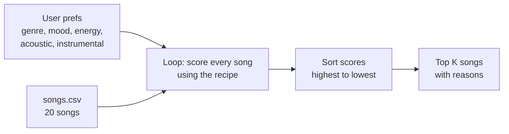

# 🎵 Music Recommender Simulation

## Project Summary

In this project you will build and explain a small music recommender system.

Your goal is to:

- Represent songs and a user "taste profile" as data
- Design a scoring rule that turns that data into recommendations
- Evaluate what your system gets right and wrong
- Reflect on how this mirrors real world AI recommenders

Replace this paragraph with your own summary of what your version does.

---

## How The System Works

Apps like Spotify and YouTube figure out what you might like next by mixing two ideas. The first one looks at other people: if someone has music taste like yours and they love a song you haven't heard yet, the app guesses you'll like it too. The second one looks at the song itself, like its genre, how energetic it is, or what mood it gives off, and finds songs that feel similar to the ones you already play. They also keep learning from what you do, like when you skip a song, replay it, or add it to a playlist. My version is a lot smaller and only uses the second idea, matching songs by what they are like. It cares most about genre, because that's the part of someone's taste that doesn't really change. Mood comes next, since it depends on what you're doing (gym vs. studying). After that it looks at energy, and it gives points for being *close* to what the user wants, not just for being higher or lower. So a calm song isn't "worse" than a loud one, it just depends on the user.

**Features each `Song` uses:**

- `genre`: the type of music (pop, lofi, rock, jazz, etc.)
- `mood`: the feeling of the song (happy, chill, intense, etc.)
- `energy`: how calm or intense it is, from 0 to 1
- `acousticness`: how acoustic it sounds, from 0 to 1
- `instrumentalness`: how much of the song has no singing, from 0 to 1 (I added this column to the dataset)

I'm not using `tempo_bpm` or `danceability` for now. In this dataset they go up and down almost the same way as energy, so adding them would basically count energy three times.

I also grew the catalog from 10 to 20 songs, adding genres and moods that weren't there before (hip-hop, country, classical, r&b, metal, reggae, edm, folk, latin, blues).

**What the `UserProfile` stores:**

- `favorite_genre`: the genre they like most
- `favorite_mood`: the mood they're looking for
- `target_energy`: how energetic they want the music to be (0 to 1)
- `likes_acoustic`: true or false, whether they like acoustic songs
- `likes_instrumental`: true or false, whether they like songs without singing

The profile I'm testing with is a "study session" listener: lofi, chill, energy 0.40, likes acoustic, likes instrumental.

**My Algorithm Recipe**

Every song starts at 0 and earns points for each way it matches the user:

| Check | Points |
|---|---|
| Genre matches | +2.0 |
| Mood matches | +1.0 |
| Energy closeness: `1 - abs(song energy - target energy)` | up to +1.0 |
| Acoustic matches what the user likes (acousticness 0.5 or higher counts as acoustic) | +0.5 |
| Instrumental matches what the user likes (instrumentalness 0.5 or higher counts as instrumental) | +0.5 |

The best possible score is 5.0. Genre is worth more than mood because genre is a long-term taste, while mood changes depending on what you're doing. I tried mood at 1.5 too, but the top 5 didn't change for any of the profiles I tested, so I kept it simple at 1.0. Each time a song earns points, the program also saves a short reason so it can explain why it picked that song.

**How songs get picked:** every song gets a score, then the list is sorted from highest to lowest and the top `k` songs (5 by default) are recommended. Scoring tells me how good *one* song is, and ranking compares *all* of them so the user only sees the best few.

**How the data flows:**



**Biases I expect:**

- It might over-prioritize genre. A song that matches the user's mood and energy perfectly can still lose to a so-so song that just has the right genre label.
- Genre and mood only count if the words match exactly, so "indie pop" doesn't count as "pop" and "relaxed" doesn't count as "chill", even though they're really close.
- Genres with more songs in the catalog (like lofi with 3) have a better chance of filling the top 5 than genres with only 1 song (like rock or metal).
- It doesn't look at whether a song sounds happy or sad, so a calm sad song and a calm happy song can score about the same.

---

## Getting Started

### Setup

1. Create a virtual environment (optional but recommended):

   ```bash
   python -m venv .venv
   source .venv/bin/activate      # Mac or Linux
   .venv\Scripts\activate         # Windows

2. Install dependencies

```bash
pip install -r requirements.txt
```

3. Run the app:

```bash
python -m src.main
```

### Running Tests

Run the starter tests with:

```bash
pytest
```

You can add more tests in `tests/test_recommender.py`.

---

## Sample Recommendation Output

This is what I get when I run `python -m src.main`. The default profile is pop/happy, and I also run my study session profile to compare:

```
Loaded songs: 20

============================================================
  Profile: Pop / Happy
  genre=pop | mood=happy | energy=0.80 | acoustic=no | instrumental=no
============================================================

  #1  Sunrise City  (Neon Echo)
      Score: 4.98 / 5.00
      Why:
        - genre match (+2.0)
        - mood match (+1.0)
        - energy close to target (+0.98)
        - acoustic preference match (+0.5)
        - instrumental preference match (+0.5)

  #2  Gym Hero  (Max Pulse)
      Score: 3.87 / 5.00
      Why:
        - genre match (+2.0)
        - energy close to target (+0.87)
        - acoustic preference match (+0.5)
        - instrumental preference match (+0.5)

  #3  Rooftop Lights  (Indigo Parade)
      Score: 2.96 / 5.00
      Why:
        - mood match (+1.0)
        - energy close to target (+0.96)
        - acoustic preference match (+0.5)
        - instrumental preference match (+0.5)

  #4  Concrete Crown  (Verse Theory)
      Score: 1.98 / 5.00
      Why:
        - energy close to target (+0.98)
        - acoustic preference match (+0.5)
        - instrumental preference match (+0.5)

  #5  Fiesta de Fuego  (Los Brillantes)
      Score: 1.95 / 5.00
      Why:
        - energy close to target (+0.95)
        - acoustic preference match (+0.5)
        - instrumental preference match (+0.5)

============================================================
  Profile: Study Session
  genre=lofi | mood=chill | energy=0.40 | acoustic=yes | instrumental=yes
============================================================

  #1  Midnight Coding  (LoRoom)
      Score: 4.98 / 5.00
      Why:
        - genre match (+2.0)
        - mood match (+1.0)
        - energy close to target (+0.98)
        - acoustic preference match (+0.5)
        - instrumental preference match (+0.5)

  #2  Library Rain  (Paper Lanterns)
      Score: 4.95 / 5.00
      Why:
        - genre match (+2.0)
        - mood match (+1.0)
        - energy close to target (+0.95)
        - acoustic preference match (+0.5)
        - instrumental preference match (+0.5)

  #3  Focus Flow  (LoRoom)
      Score: 4.00 / 5.00
      Why:
        - genre match (+2.0)
        - energy close to target (+1.00)
        - acoustic preference match (+0.5)
        - instrumental preference match (+0.5)

  #4  Spacewalk Thoughts  (Orbit Bloom)
      Score: 2.88 / 5.00
      Why:
        - mood match (+1.0)
        - energy close to target (+0.88)
        - acoustic preference match (+0.5)
        - instrumental preference match (+0.5)

  #5  Coffee Shop Stories  (Slow Stereo)
      Score: 1.97 / 5.00
      Why:
        - energy close to target (+0.97)
        - acoustic preference match (+0.5)
        - instrumental preference match (+0.5)
```

**Screenshot or video** *(optional)*: <!-- Insert a screenshot or demo video link here -->

---

## Experiments You Tried

Use this section to document the experiments you ran. For example:

- What happened when you changed the weight on genre from 2.0 to 0.5
- What happened when you added tempo or valence to the score
- How did your system behave for different types of users

---

## Limitations and Risks

Summarize some limitations of your recommender.

Examples:

- It only works on a tiny catalog
- It does not understand lyrics or language
- It might over favor one genre or mood

You will go deeper on this in your model card.

---

## Reflection

Read and complete `model_card.md`:

[**Model Card**](model_card.md)

Write 1 to 2 paragraphs here about what you learned:

- about how recommenders turn data into predictions
- about where bias or unfairness could show up in systems like this


